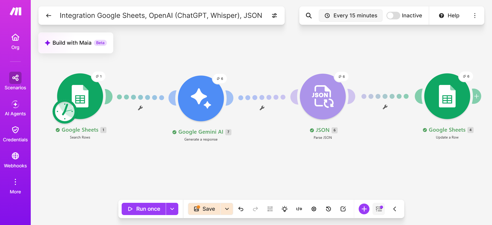
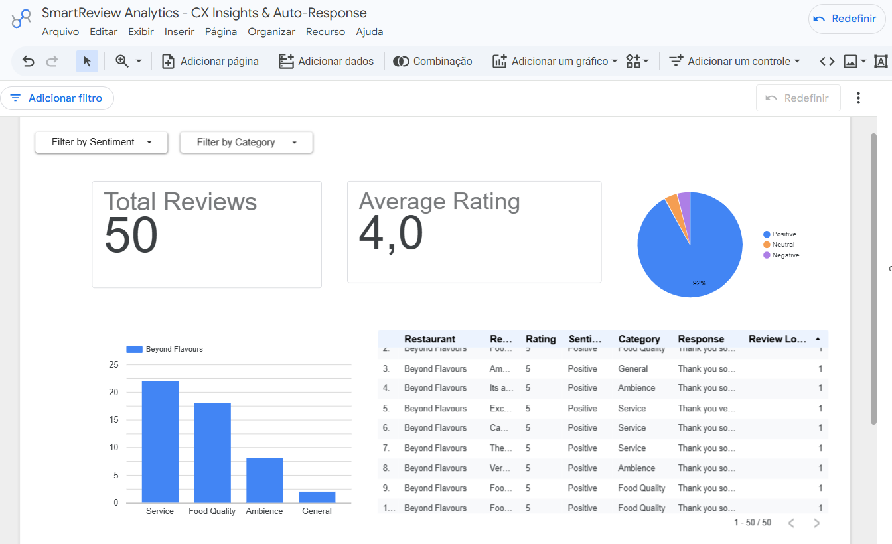

# SmartReview: classificação e rascunho de respostas para avaliações de restaurantes

Automação no Make que lê avaliações de clientes numa planilha, usa o Gemini para classificar sentimento e categoria, redige um rascunho de resposta e, na v2, envia os casos sensíveis para revisão humana. Os resultados alimentam um dashboard no Looker Studio.

> **Status:** v1 concluída e avaliada. v2 (prompt revisado) em teste nas mesmas 50 avaliações. Os números da v2 serão adicionados quando a comparação terminar.

## Problema

Responder avaliações uma a uma toma tempo, e ler dezenas delas não mostra quais problemas se repetem. O objetivo é que a pessoa responsável pelo restaurante revise rascunhos prontos, em vez de escrever do zero, e veja num painel onde estão as reclamações.

## Como funciona

1. **Google Sheets:** o Make busca as linhas que ainda não foram analisadas.
2. **Gemini (`gemini-3.5-flash-lite`):** recebe a nota e o texto e devolve um JSON.
3. **Parse JSON:** separa os campos.
4. **Google Sheets:** grava os campos nas colunas da linha. Na v1: `sentiment`, `category` e `response`. Na v2, também `issue_summary` e `needs_human_review`.
5. **Looker Studio:** mostra totais, nota média, sentimento e categorias.

O cenário roda a cada 15 minutos quando ativado. As respostas são **rascunhos**: nada é publicado automaticamente.

*Print da v1. A nota média aparece como 4,0, mas o valor real das 50 avaliações é 4,66: o indicador estava usando contagem distinta em vez de média. A correção está entre os próximos passos.*

## Dados

50 avaliações do dataset público [10000 Restaurant Reviews (Kaggle)](https://www.kaggle.com/datasets/joebeachcapital/restaurant-reviews), todas do mesmo restaurante. Cada avaliação recebeu um ID fixo, de R001 a R050, e os nomes dos avaliadores foram removidos da amostra publicada aqui.

## Como a qualidade é medida

Cada versão roda sobre as **mesmas 50 avaliações**, para que a diferença venha só do prompt.

- **Gabarito manual:** sentimento e categoria classificados por mim, sem ver as saídas da IA.
- **Casos de regressão:** 7 respostas da v1 com erros concretos. A v2 precisa corrigir todos.
- **Regras verificáveis:** limite de 2 frases e envio para revisão humana das notas 3 ou menores.

As métricas são calculadas com fórmulas numa aba de comparação da planilha, que se atualiza conforme o gabarito e a v2 são preenchidos.

### Resultados

| Métrica | v1 | v2 |
| --- | --- | --- |
| Respostas com até 2 frases | 40% (20 de 50) | pendente |
| Casos de regressão aprovados | 0 de 7 | pendente |
| Acerto de sentimento (vs. gabarito) | pendente | pendente |
| Acerto de categoria (vs. gabarito) | pendente | pendente |
| Notas ≤ 3 enviadas para revisão | campo não existia | pendente |

### Erros encontrados na v1

| ID | Problema | Regra criada na v2 |
| --- | --- | --- |
| R002 | Agradeceu ao cliente chamando-o pelo nome do garçom | Nomes citados são de funcionários |
| R010 | Tratou uma funcionária como se fosse um lugar | Nomes citados são de funcionários |
| R015 | Prometeu "resolver a situação" | Proibido prometer soluções |
| R022 | Disse que o cliente gostou da comida, apesar da crítica ao sabor | Não distorcer a opinião do cliente |
| R030 | Comemorou a nota antes de tratar a queixa sobre espera | Reconhecer a queixa em notas altas |
| R031 | Prometeu "resolver a situação" | Proibido prometer soluções |
| R046 | Disse que o restaurante já estava melhorando a organização | Não inventar ações em andamento |

Outro achado: o prompt da v1 pedia a resposta em inglês numa regra e em português no modelo de JSON. O modelo seguiu a regra marcada como `CRITICAL`. Na v2, o idioma aparece uma única vez.

## O que mudou no prompt

Compare [`prompts/prompt_v1.txt`](prompts/prompt_v1.txt) com [`prompts/prompt_v2.txt`](prompts/prompt_v2.txt).

- Critério de sentimento baseado no texto, com a nota como contexto.
- Definição de cada categoria e regra para escolher o tema principal.
- A avaliação vai delimitada por `<review>` e é tratada só como dado, para reduzir o risco de *prompt injection*.
- Campos novos para a operação: `issue_summary` e `needs_human_review`.
- Proibições explícitas: promessas, ações inventadas e confusão de nomes.

## Limitações

- Amostra pequena e de um único restaurante, com 94% das notas em 4 ou 5. Há poucos casos negativos para testar respostas a reclamações.
- O gabarito é feito por uma única pessoa, então o acerto mede concordância com o meu julgamento.
- A contagem de frases é aproximada pela pontuação.
- Ganho de tempo e custo por avaliação ainda não foram medidos.

## Próximos passos

1. Concluir a comparação v1 x v2 e publicar os resultados.
2. Corrigir a nota média no dashboard.
3. Rodar uma amostra de 200 avaliações de vários restaurantes, com 40 por nota.
4. Medir tempo manual vs. automação e custo por avaliação.
5. Tratar JSON inválido marcando a linha como erro, sem parar o cenário.
6. Publicar o cenário exportado do Make (*blueprint*), sem credenciais.

## Arquivos

- `prompts/prompt_v1.txt`: prompt original.
- `prompts/prompt_v2.txt`: prompt revisado.
- `data/amostra_v1_anonimizada.csv`: as 50 avaliações com as saídas da v1, sem nomes de avaliadores.
- `imagens/`: prints do cenário e do dashboard da v1.
